<p align="center">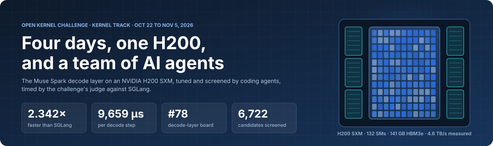</p>

I joined the [Open Kernel Challenge](https://openkernelchallenge.dev/) on a whim, four and a half days before the kernel
track closed. A team of AI coding agents wrote, measured and tuned the kernels on rented H200s, and I steered.

We finished at **2.342x faster than SGLang** on the decode-layer board (9,659.4 µs per decode step), **rank #78** on that
board and overall. The #1 entry finished at about 2.61x.

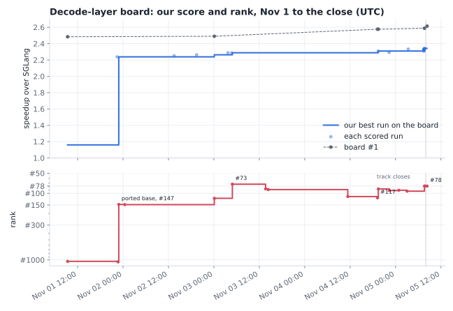

The short version:

- Our first kernels, written in the first hours, were slower than SGLang. Our best scored run was 2.342x, and in paired
  runs on our own pipeline the final file is 4.1% faster than our first scored file on the public base.
- The agents built a pipeline that reproduced the judge's timing and screened 6,722 candidates on rented H200s. It
  queued about 1,090 400-repetition confirmations, and 64 changes became the new incumbent.
- The judge's run-to-run noise is about ±1.5%. Most real wins were 0.1 to 0.8%. Measurement design mattered more than
  any single kernel idea.
- The agent system needed tuning as much as the kernels did. Almost every rule I gave the agents was a fix for a
  specific failure, and most of those failures came from adding process, not from missing it.
- We reverse engineered parts of ptxas and built a Lean 4 model of PTX on the H200. Both taught us a lot about the
  machine and turned into very little score.

## Contents

- [How it started](#how-it-started)
- [The challenge](#the-challenge)
- [The agent system](#the-agent-system)
- [How I ran it, and how it was tuned](#how-i-ran-it-and-how-it-was-tuned)
- [Measuring like the judge](#measuring-like-the-judge)
- [The screening pipeline](#the-screening-pipeline)
- [GPUs and money](#gpus-and-money)
- [What we learned about the H200](#what-we-learned-about-the-h200)
- [The kernels](#the-kernels)
- [Searching for better math: the NVFP4 decode](#searching-for-better-math-the-nvfp4-decode)
- [Reverse engineering ptxas](#reverse-engineering-ptxas)
- [A Lean model of PTX on the H200](#a-lean-model-of-ptx-on-the-h200)
- [The last morning](#the-last-morning)
- [What's in this repo](#whats-in-this-repo)
- [Credits](#credits)

## How it started

On October 31 at 18:13 UTC, in the middle of other work, I asked an agent whether we could take part in the challenge.
At 20:48 I asked for one expert agent to work on it independently, using everything we had learned from our own kernel
work on [Dew](https://github.com/AshishKumar4/dew) and from public references, and to climb the leaderboard "in as few
attempts as possible". I logged in to the challenge CLI at 20:51. The track closed on November 5 at 07:59 UTC.

The first plan predicted 2.5 to 2.8x on the decode layer. The agent wrote four kernels and the layer composition in
about four hours: a skinny GEMM, a W4A16 MoE, split-KV attention and the glue, 7,918 lines in its first kernel commit.
Every check passed its tests. The speeds were 0.97x on the layer, 1.21x on attention, 1.16x on the MoE and 1.02x on
the projections. By the morning of November 1 our board row was 1.16x, at rank #1,050.

On November 1 we moved onto [keell0renz's public kernels](https://github.com/keell0renz/muse-open-kernel-challenge),
which build on code by vjeux, alygg77, chenwainuo, ZhimaoL, Madhavan113, Matsvei and NathenFernandes (see
[Credits](#credits)). That base checked at 2.265x on the decode layer. Our first scored run on it, at 22:26 UTC, was
2.238x, and we went from #1,071 to #147.

## The challenge

Each problem is one piece of the Muse Spark model's decode step, sharded TP8/EP8, timed on an H200 SXM against SGLang's
own kernels:

| Board | What it computes | SGLang time | #1 when we started |
|---|---|---|---|
| bf16 projections | `x @ W^T` for the layer's five projections, 1 to 256 tokens | 4,831 µs | 1.65x |
| attention decode | gated GQA over a paged FP8 KV cache at 80K context, with QK-norm, RoPE and the cache write | 3,766 µs | 3.22x |
| MoE W4A16 | top-8 of 256 experts (32 local), SwiGLU over NVFP4 weights | 13,449 µs | 2.76x |
| decode layer | the whole layer: all of the above plus norms, router and residuals | 22,620 µs | 2.46x |
| prefill layer | the whole layer at 753 and 16,384 tokens | | |

The overall rank followed the decode layer, so that board got nearly all of our time.

The decode layer has 12 scored cases: plain decode with 1, 16 or 32 requests, and speculative verify (8 query tokens)
with 1, 16 or 32 requests, each on a sliding-window layer and a full-attention layer. A load's time is 46 sliding
layers plus 16 full layers, as in the real model, and the score is the geometric mean of the six loads' speedups. That
formula decides where a microsecond is worth the most:

| Score per µs saved | decode 1 | verify 1 | decode 16 | decode 32 | verify 16 | verify 32 |
|---|---|---|---|---|---|---|
| sliding layer | 0.196% | 0.120% | 0.088% | 0.071% | 0.049% | 0.037% |
| full layer | 0.068% | 0.042% | 0.030% | 0.025% | 0.017% | 0.013% |

One microsecond off decode-1 sliding is worth as much as 15 off verify-32 full. Early on, our priorities weighted all
12 cases equally, until the advisor (below) flagged it. From then on every agent got this table in its brief.

The judge runs `prepare(weights)` once, untimed, for up to 300 seconds, so weight repacking and lossless compression go
there. Then it captures each shape as a CUDA graph, replays it cold-L2 in turns with SGLang on fresh inputs, and takes
the median of order-swapped paired ratios. It returns a per-case table with SGLang's time, yours and a speed-of-light
bound, plus a per-kernel profile. Each problem had a daily budget of scored runs and of unscored "checks". The same code
submitted twice returns its earlier result, and a board row keeps your best run.

## The agent system

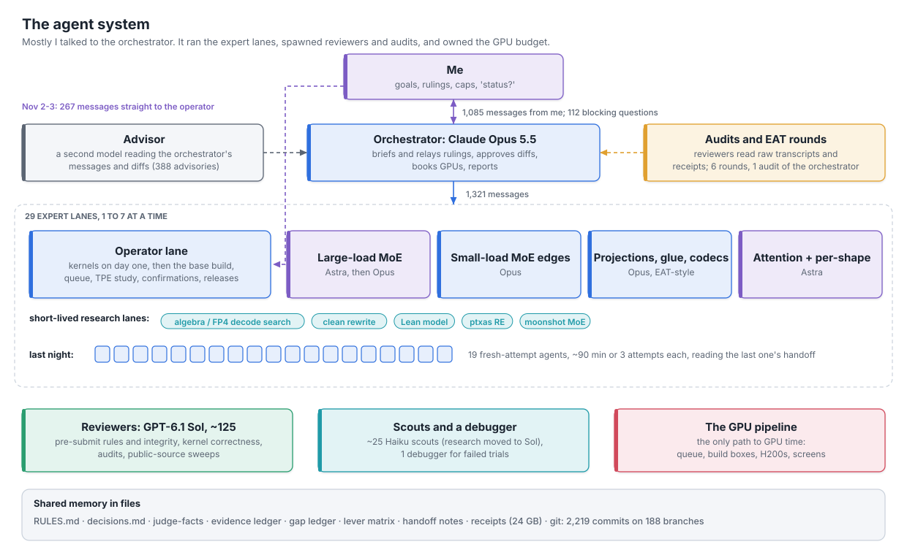

Mostly I talked to one agent, the orchestrator (Claude Opus 5.5). It wrote the briefs, relayed my rulings, approved
diffs, booked GPUs inside the caps I set, spawned reviewers and audits, and answered my constant "status?". Over the run
it sent 1,321 messages to the expert lanes. For about a day, from November 2 at 05:43 to November 3 at 04:10, I also
talked straight to the operator lane, 267 messages, while the orchestrator kept relaying everything else.

**Expert lanes** did the real work. Each was a long-running agent with its own git worktree and an area it owned. 29 ran
over the four days, 1 to 7 at a time: 26 on Claude Opus 5.5 and 3 on GPT-6 Astra. Experts wrote all of their own code.
They could spawn reviewers, scouts and debuggers, never another coding agent. That rule came from the first hour, when
the first lane spawned helper agents to write code for it.

**Reviewers** ran on GPT-6.1 Sol, a different model family from the builders, and were always read-only. About 125
reviewer sessions touched the challenge: a rules-and-integrity review before every scored run, correctness reviews of
new kernels before their only run on a GPU, transcript audits, and sweeps of public sources. Their findings went only
to the orchestrator, which judged them before anything reached a lane.

The audits that mattered most read the lanes' raw sessions, tool results included. On the night of November 2 I asked for
one over every lane, and it found results we had been trusting that weren't real: a prefetch experiment whose arguments a
helper had cleared, so it never prefetched; a result recorded as 1.0095 whose receipt read 1.0043, because receipt files
were reused and overwritten; and screens logged as checking 20 inputs that checked 4. Every receipt became immutable and keyed by run id, candidate md5, source flags and seeds, and no receipt name is ever reused. A
timeout is "no result" and a compile-only success is "not measured". Later, the relay refused a job name it already held,
so a screen could no longer silently not run, and every screen and confirmation went back automatically to the agent
that owned the idea, with per-case deltas. Before that, lanes were sometimes deciding from readings hours old.

**An advisor**, a second model watching the orchestrator's messages and diffs, injected 388 advisories in the window.
It caught real problems: the equal-weight objective above, a GPU runner that returned a score after a failed output
check, budget arithmetic that could pass a $30 cap at $33, and A/B re-reads creeping back in after I had removed them.

**Shared memory lived in files**, not in any agent's context: `notes/decisions.md` for my rulings, `judge-facts.md` for
what the judge's H200 measured, an evidence ledger, a gap ledger per case, a lever matrix, handoff notes, 24 GB of
receipts, and git (2,219 commits on 188 branches). The orchestrator's own session restarted five times when my PC ran
out of memory and compacted five times. The files carried everything across.

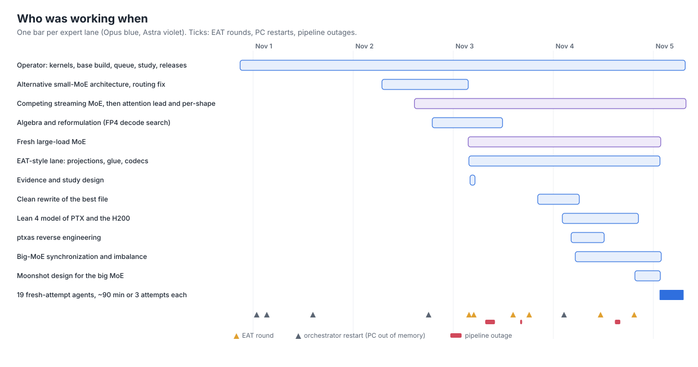

The lanes changed a lot over the run:

1. **Day one: one lane.** It built everything from scratch, then rebased onto the public kernels.
2. **November 2: competing lanes.** I asked for a lane on a second model family, GPT-6 Astra, building a from-scratch
   streaming MoE "on a different track/ideology", plus an algebra lane whose brief was "change the computation, not the
   schedule". The Astra MoE got from 0.81 to 0.967 of the base and never overtook it. The algebra lane found the NVFP4
   decode below.
3. **November 3: roles.** The first lane became the operator: base build, queue, studies, releases. New lanes each owned
   one kernel family. Each new lane's brief named what the others did and what it must not do.
4. **November 4: research lanes.** A clean rewrite of the best file, a Lean model, ptxas reverse engineering, a
   moonshot design for the large-batch MoE. I folded lanes when their roles overlapped or their yield stopped.
5. **The last night: fresh agents.** After reading [lxe's write-up](https://lxe.co/muse-swarm/) I replaced the three
   long-lived MoE and projection lanes with short-lived agents. Each got about 90 minutes or 3 attempts, then a new one
   started from the previous one's handoff note. 19 of them ran between 01:29 and 06:00 UTC. The biggest late win, the
   router sum moved off the pooler (+0.51%), came from the first of them.

Each fresh agent's brief carried the per-case sensitivity table, the area it owned and a read-first list. A change had
to be a compile-time `-D` flag, off by default and SASS-identical when off. The agent committed it on a branch off the
current tip and sent the operator the commit, the flag and the target cases. Before building an idea, it predicted the
microseconds from the gap numbers, and skipped ideas predicted under about 0.3 µs on a weighted case. The brief ended
with the rule: "No A/B runs, no re-reads, no extra suites, no reviews, no soaks. The screen and the confirmation are the
judge."

### EAT rounds

On November 3 I felt we were stuck in a local minimum and pointed the orchestrator at
[EAT](https://github.com/caoshiyi/EAT) (Evolving Agent Teams): a supervisor that never touches the solution, reads the
team's transcripts when the score stalls, names what holds it back, and creates the role that attacks it. We ran it
with read-only reviewers doing the reflect step, plus one EAT-style builder lane that ran the loop on itself. Six
rounds:

| Round | What it found | What changed |
|---|---|---|
| 1 | a corrupted experiment history (observations attached to the wrong option sets) and a search space with inert dimensions | history quarantined; operator and study-design roles split |
| 2 | a test bug that hid a lead (an early KV-load patch only flipped a flag), and the transposed MoE as a new design | the transposed MoE was built and measured 0.78 to 0.86x |
| 3 | only 0.42 measured trials per minute, and the TPE "best" was the incumbent's cached copy | pipeline frozen |
| 4 | our measurement matched the judge's; we were optimizing visible work, not exposed latency | the per-shape direction, which converted (+0.44%) |
| 5 | no leader's code public; per-shape variants everywhere at the top | lane folds; one recommendation measured decisively worse (+18.6 µs at decode-16 sliding) |
| 6 | a retrospective: "EAT helped us stop, prioritize and remember", and found no route to the leaders | stopped broad rounds; the next change was the fresh-agent refresh |

The most useful single diagnosis was round 4's: decode-ahead removed instructions from the MoE, but the MoE's end time
didn't move, because the kernel was waiting on memory and synchronization, not on issue.

## How I ran it, and how it was tuned

I was away a lot. I sent about 1,085 messages in the window, about 670 of them about the challenge. The median was 121
characters, and 41% were under 100. Many were a quoted line from the orchestrator followed by "why?". About 22 were "going afk now", and the longest
gap was five hours. Before going away I left standing orders: "dont add any more processes or unnecessary beuracracy,
work calmly and chill"; "submit the best run we have had, measure the compile time variants... don't disturb the
pipelines, keep feeding it ideas"; budgets and price caps for each provider; and a cap on expert lanes.

Each rule below came from a dated failure.

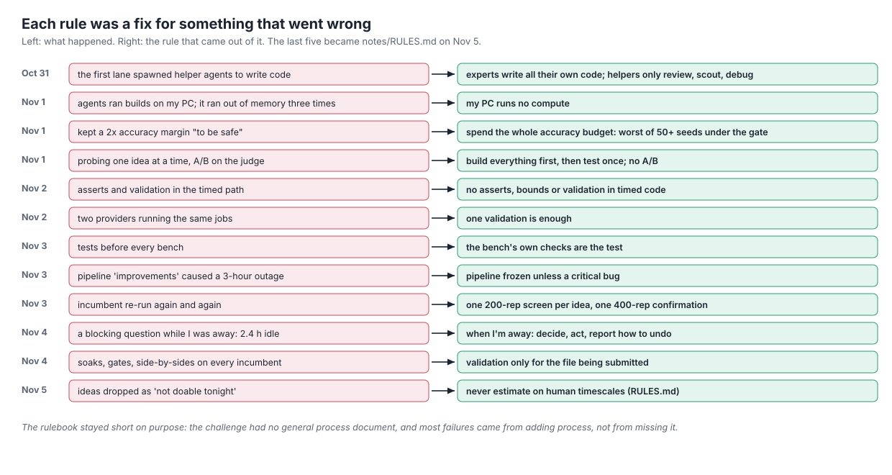

### Process in the measurement path

The agents kept adding careful-looking process: gates, matched controls, order-swapped re-runs of the incumbent, soaks
on every new incumbent, cross-checks between providers, tests before every bench. Each one was defensible on its own.
Together they ate the GPUs. On November 3 a breakdown of GPU wall time showed timed repetitions at 18%, input setup 18%
and checks 13%. On the afternoon of November 4, soaks, gates and side-by-side screens took about a quarter of all GPU
time and pulled throughput from 6.9 to 1 to 3 benches per minute.

Our own noise numbers said extra controls rarely change a decision. The incumbent's screen-to-screen
spread was 0.07 to 0.25% (2 sd), and promoting a candidate that is secretly equal to the incumbent costs nothing. The
fix was one 200-repetition screen per idea against the incumbent's established reading, one 400-repetition confirmation
per bundle, and validation only for the file being submitted. I had to restate it five times, the last at 04:14 on the
final night: "are we still doing A/Bs? Controls crap? We have established numbers for stuff! We dont need redundant
runs!"

### Idle GPUs and silent stalls

The worst stall came on the morning of November 3. To speed things up, an agent put both GPUs' compiled extensions into
one shared build directory. When the bench timeout killed hung jobs, it left torch's build-lock files behind, and every
later bench waited forever on them. From about 07:40 to 10:00 UTC both GPUs measured 2 trials. The stall alert counted
any report as progress. The orchestrator relayed an agent's "71 GPU jobs an hour, up from 48", which counted jobs, not
measured trials. The GPU watcher read zero completions as backlog and booked two more boxes. In the same window a
stream-K option hung in `prepare()` on all 10 of its trials, spinning on a flag nobody set, and `nvidia-smi` showed the
GPUs "100% busy" at about 135 W.

I asked for an audit of the orchestrator itself. An independent reviewer read 24 hours of raw sessions and counted 39
episodes: 27 decisions the orchestrator had to reverse or correct (14 against an explicit instruction of mine or a
clear rule) and 12 materially wrong reports. It named the pattern "supervision by narrative": taking a lane's
explanation, a successful command or a "completed" counter as proof that work had happened, and answering every block
with a new mechanism. The fixes were behavioural: check the premise in the study's database first and say "unknown"
when you don't know; change one thing at a time; never add machinery while a failure is unexplained. The mechanical
fixes were a stall alert after 25 minutes without a *measured* trial, a stall that blocks GPU booking instead of
triggering it, and per-GPU power telemetry, because real work on an H200 draws well over 250 W.

That afternoon I froze the pipeline: "most of the pipeline should not be touched unless some critical bug is found.
everytime you have touched it unnecessarily, things have broken for worse". It held better after that, though not
perfectly. An 80-minute slowdown on November 4 came from new lock machinery, and I reverted the pipeline to that
morning's state.

### Questions while I was away

The orchestrator's `ask` tool blocks until I answer. In the window it asked 112 questions, and they were blocked for
about 5.8 hours in total. The worst one sat for 2.4 hours on November 4 while I was away, and the whole session waited
with it. The fix was an away protocol: while I'm away, the orchestrator decides, acts,
and reports what it did and how to undo it. Only `okc submit` waits for me.

### Human-timescale estimates

Agents kept sizing work as if a person would write it: "94 hours" to match a public 460-experiment stack, "poor
gain-to-effort ratio, I'll skip", "30 to 40 h" for a persistent chain, and at 02:14 on the last night, "Not doable
tonight" for a public W4A16 MoE library. Coding was never the bottleneck. Only GPU time was. I repeated this more than a
dozen times, and on the last night it became the first line of `notes/RULES.md`. The orchestrator then listed every
idea it had dropped for effort and assigned them. The MoE library was vendored and measured within about 11 minutes. It
lost on all 12 cases (35.0 µs against our 15.7 at decode-1 sliding), but it lost on a measurement, not on an effort
estimate. Fresh agents still predicted each idea's microseconds before building it, as a filter.

### Over-predicted gains

Every plan came with a predicted gain, and structural predictions had the wrong sign every time. The dead list by
November 2 recorded "0 for 12 on sign":

| Design | Predicted | Measured |
|---|---|---|
| CTA-local MoE | +2 to 3% | -25% |
| two alternative MoE designs | +1.5 to 3% | -11% and -18% |
| folding kernels together | a small gain | +21 to 27 µs |
| a persistent layer kernel | "should win" | lost (1.4 to 1.6 µs per grid hop) |
| transposed MoE | +2 to 4% | 0.78 to 0.86x |

What held predictions to evidence was cross-checking claims against `judge-facts.md`, the advisor, a dead list grouped
by the class of evidence that killed each idea, and one sentence from the round-4 audit: stop counting TPE trials,
compiler fixes or instruction cuts as score progress.

### Scale

| | |
|---|---|
| agent sessions on the challenge | about 191: 29 expert lanes, about 125 reviewers, about 25 scouts, 1 debugger |
| orchestrator to lane messages | 1,321 |
| expert-lane activity | about 25,400 assistant turns and 28,600 tool calls |
| commits | 2,219 on 188 branches, 126 of them one per idea |
| candidate files | 9,774 |
| optimizer trial records | 15,822 whole-layer plus 21,463 per-case |
| harness code the agents wrote | about 6,800 lines of Python and shell |

## Measuring like the judge

The judge gave us a few dozen timings a day. We needed thousands, and they had to agree with the judge.

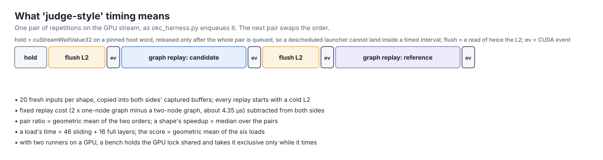

[`harness/okc_harness.py`](harness/okc_harness.py) runs inside the challenge's own Docker image and times a candidate
the way `TASK.md` describes the judge: 20 fresh inputs per shape copied into both sides' captured buffers, a read of
twice the L2 before every replay, paired repetitions with the order swapped, a fixed replay cost subtracted, and the
median of pair ratios. A failed output check means no score. Two details took a few tries:

- **The flush must read, not write.** The first version wrote the buffer, and dirty lines skewed the cold timings.
- **The host must not land inside a timed interval.** With two benches sharing a box's CPUs, a descheduled launcher
  could stall mid-measurement. The harness holds the stream on `cuStreamWaitValue32` against a pinned host word,
  enqueues the flush, events and replay, and only then releases the word.

The harness became judge-faithful in a single night, after one failed calibration. On November 2 I rented an H200 on
RunPod for two hours. Production scored 2.34x there against the judge's 2.2376x, with cases off by -12% to +11%. The
cause was method: the harness timed one input per case, while MoE routing moves with the data. Fresh inputs per
repetition, the replay-cost fix and order-swapped pairs landed between 05:42 and 06:47 UTC. After that, production's
per-case times matched the judge within -4.6% to +0.6%.

**Absolute numbers didn't transfer; paired ratios did.** Modal's H200 read 6.7% high, the RunPod
pod 5% high, and the judge draws new seeds every run, which moves the MoE several percent. But candidate-against-production
ratios carried over almost exactly: +0.63% locally against +0.65% on the judge for one change, +1.10% against +1.14% for
another. Every reading after that was a ratio against production on the same GPU, inputs and process.

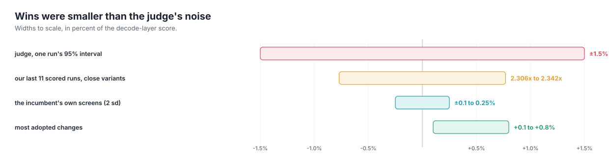

## The screening pipeline

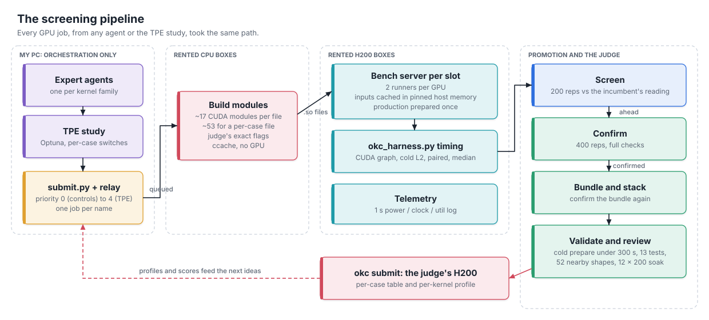

**The first GPUs spent about 1% of their time timing.** On November 3 the agents measured where GPU wall time went on
three H200s: compiling 37 to 53%, other setup 44 to 51%, timed repetitions 0.6 to 1.5%. Most of the compile share was one
bug: a Python-hash-seeded extension name made every process rebuild the routing extension, and one box held 568 copies
of the same build. Fixing that, and moving everything that isn't timing off the GPU, was the throughput lever. More
GPUs were not.

The pipeline that came out of it, much of it from my design messages that day ("have an async queue where we keep
compiling and pushing benches, and the gpus keep pulling from them, and we keep monitoring the queue's size"):

- **One flow for everything.** Every GPU job, from an agent or the TPE study, goes through
  [`submit.py`](harness/submit.py) with a priority level that is kept end to end: 0 for a new incumbent's first
  controls, 1 for confirmations, 2 for agents' experiments, 3 for sweeps, 4 for TPE draws. Before this, agents' jobs and
  study trials took different paths.
- **A relay on my PC.** The rented boxes can't reach my PC, so [`relay.py`](harness/relay.py) makes every move: it
  holds the build queue and every job's state, starts builds, and tells a build box to ship straight to its GPU box once
  that GPU has fewer than five jobs waiting. My PC runs no compute.
- **CPU build boxes.** A candidate needs 17 CUDA modules (52 to 63 for a per-case candidate). Cheap CPU-only boxes build
  them with the GPU boxes' exact paths and flags, faking an H200's device properties, so the `.so` files load without a
  rebuild. ccache keyed without the folder path, and tvm-ffi modules published by one atomic rename, took the clean
  codebase's median build to 1 second on a cache hit (mean 17 s), against 134 seconds for the old codebase.
- **A persistent bench server per GPU slot.** [`benchd.py`](harness/benchd.py) holds the reference, the weights,
  production's prepared state and the flush buffer once, and memoizes the reference's results per input in host memory.
  A bench went from about 38 s to 18 to 25 s, checks from 34 to 53 s to 7 to 13 s. Scored inputs (12 cases x 20 seeds,
  about 158 GB) live on disk, mapped read-only and registered with CUDA, which took decode-32's 14 GB of inputs from
  2.1 s to 0.3 s per bench. The server restarts after 25 requests, 30 idle minutes or any CUDA error, and before trusting
  it the agents ran a carryover test: incumbent, two very different candidates, incumbent again, all readings matching a
  fresh process.

Build boxes were the hardest operational problem. About 28 of them came and went in a day: hosts that never started,
went offline, ran their cores at 400 to 1,500 MHz (a tiny extension took 1,111 s instead of about 1), or uploaded at
13 KB/s. I capped them at $0.50/h combined. The agents learned to benchmark a box's single-core speed on arrival and
destroy anything slower than 2.5 s on a fixed loop.

### Screens, confirmations and controls

- A **screen** is one candidate, 200 repetitions, all 12 cases, read against the incumbent's established reading. It
  checks 4 inputs through the exact timed graph. Median bench body: about 32 seconds.
- A **confirmation** is the same at 400 repetitions with full checks (20 inputs, eager and through the graph).
- On the last night, every screen winner since the last adoption went into one **bundle** with one confirmation every
  20 minutes or so, instead of confirming ideas one at a time.
- Only the file being submitted got **validation**: frozen source, asserts removed, cold `prepare` with every cache
  empty under 300 s, the 13 task tests, 52 nearby shapes, and a 12 x 200 replay soak.

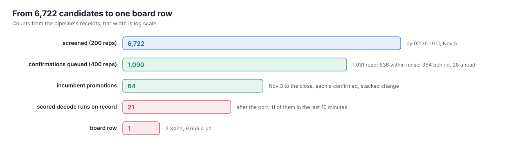

Only 28 of 1,031 confirmations came back "ahead"; 636 were within noise. Adopting "within or ahead" changes, under my
rule that every win counts and stacks, is how small gains accumulated.

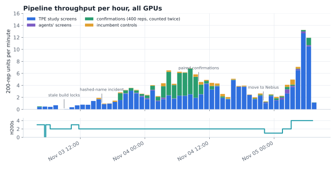

Throughput went from 0.4 measured trials per minute on the morning of November 3 to 3 to 7 on November 4 and a peak of
13.3 per minute on four GPUs on the last night. The dips are almost all self-inflicted: the stale build locks, a change
to hashed extension names that made every bench compile on the GPU, paired confirmations that took throughput to zero
for twenty minutes before I reverted them, and the move to Nebius.

### The TPE study

[`harness/clean_study.py`](harness/clean_study.py) runs Optuna's TPE sampler (multivariate, grouped, constant liar so
parallel GPUs don't draw the same point) over the layer's compile-time switches.

- **Too many dimensions, too few trials.** After I said every win counts and to let TPE decide, every built option
  became a dimension: 88 of them at one point, about 19 switched on per trial, 179 measured trials. An audit found two
  real flaws: candidate crashes were recorded as failures, which TPE ignores, so it kept resampling broken options; and
  two benches sharing a GPU spread one candidate's hang to its neighbour. TPE's "good" set was the global top 25, all on
  production's MoE, so any new option looked bad by construction.
- **TPE re-found the incumbent but didn't beat it on its own.** Of trials scoring at least 1.016, 31 were seeded and only
  4 were free draws. Every win banked that day came from an agent's direct test.
- **What worked in the end:** the clean codebase's compile-time switches, each defaulting to the incumbent's value so a
  default draw writes nothing; a failure share that fell from 54% to 0.5%; a regression over all measured trials (the
  "harvest") that found `rq_o` worth +0.61% (t = 10.4); and per-case studies, one per scored case. The per-case study
  was in fact drawing at random until about 04:00 UTC on the last night, when a bug was fixed. Its picks are in 11 of the
  final file's 12 cases.

We never ran a genetic algorithm. Our space was small, discrete and noisy, and bundling already did a GA's main trick,
combining winners. The limit was how little the study searched over, not the optimizer.

## GPUs and money

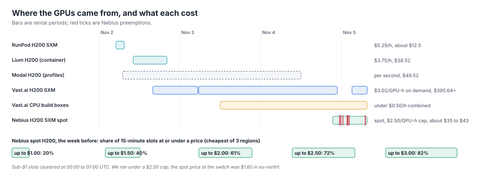

| Provider | What it gave us | Cost |
|---|---|---|
| RunPod H200 SXM | two hours on the real part, and the calibration that fixed the harness | about $12.5 |
| Lium H200 | the steadiest timing we had (A/A 1.0000, every shape ±0.1%), but no root, so no counters; it vanished at its 10-hour limit | $38.52 |
| Modal H200 | Nsight Compute on demand, budget-guarded; read 6.7% high against the judge | $49.52 |
| Vast.ai | the main fleet: H200 SXM at $3.02/GPU-h on demand, plus CPU build boxes | $395.64 invoiced, plus the last hours |
| Nebius | spot H200 SXM for the last nine hours, under a $2.50/GPU-h cap | about $35 to $43 (estimated) |

That's about $480 to $490 for Vast, Modal and Nebius, and about $530 with RunPod and Lium.

The move to Nebius came from lxe's post, which said their last four days on spot H200s cost under $175. Nebius had moved
to dynamic spot pricing in October. Its public price feed showed $1.60 in eu-north1 that evening, against our $6.42/h
on Vast. The agents built [`harness/h200/nebius.py`](harness/h200/nebius.py) in about an hour: a watcher that reads the
feed each minute, a pricing policy per region so Nebius itself never bills above the cap, region moves when another
region stays $0.50/h cheaper for 30 minutes, and the judge's image running as a long-lived container whose command is
the box's boot, so a VM that comes back after a preemption brings up its runners, queue and inputs by itself. A region is
ranked by price per productive hour, `price x (1 + 600 s / median run between stops)`.

We were preempted 10 times in nine hours. The median run between stops was 19 minutes in eu-north1 and 5 in eu-west1,
and recovery took 2 to 6 minutes to the next bench. One Nebius GPU did 3.8 to 6.1 runs per minute, as much as Vast's
pair, and the burn rate fell from $6.42/h to about $2/h. Nebius also gave us root and Nsight Compute counters, which
Vast and Lium didn't; we found that at 04:20 on the last morning.

## What we learned about the H200

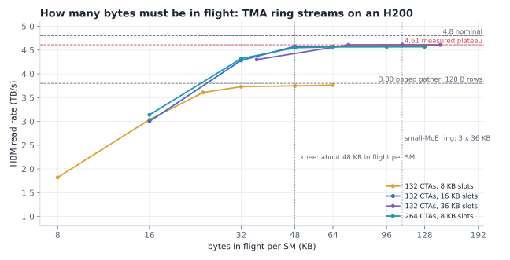

**HBM tops out at 4.61 TB/s, and you need about 48 KB in flight per SM to get there.** On the judge, streaming reads
reached 4.58 to 4.70 TB/s with TMA rings of 16 to 36 KB stages on 132 CTAs, higher than the 4.2 to 4.45 TB/s others had
reported. A ring microbenchmark pinned the curve: 1.82 TB/s at 8 KB per SM, 4.28 at 32 KB, 4.58 at 48 KB, flat after.
Latency follows Little's law past the knee. When an agent's report on November 4 treated 3.5 TB/s as a theoretical
limit, I pointed at our own numbers: "that 3.5tb/s - that doesnt sound like theoretical limit? We have measured 4.5-4.7
too right?" Our small-MoE ring already holds 108 KB per SM, which explains why more
than a dozen ideas that added bytes in flight or prefetches to the MoE all lost. One issuing thread that waits and reissues
costs about 571 cycles per copy, so small copies need more issuers: 132 CTAs with 6 x 8 KB slots stay at 3.75 TB/s,
while 264 CTAs with the same bytes in flight reach 4.57.

**Paged attention has its own ceiling.** With page size 1, every K/V row is a random 128-byte read. `cp.async` of 16 B
per thread reached 3.80 TB/s whatever the stage count, CTA count or producer warps. Bulk copies of one 128-byte row each
reached only 2.0 to 3.35 TB/s, which killed a model-ranked idea to feed attention through a TMA ring.

**Small batches are fixed costs.** At 16 tokens or fewer, time goes to a completion counter with over a thousand pollers
seen about 3 µs late, a helper warp's queue (1.5 to 1.9 µs), a fence (0.5 µs), a grid barrier (1.2 µs) and kernel
prologues (about 2.9 µs). Some measured costs:

| | |
|---|---|
| shared memory / DSMEM / L1 hit | 28 / 186 / about 41 cycles |
| L2 hit | about 270 cycles |
| dependent HBM load | about 660 cycles |
| mbarrier arrive to try_wait, same CTA / across a cluster | 65 / 395 cycles |
| `fence.acq_rel` at `.cta` / `.gpu` / `.sys` | +23 / +274 / +1,155 cycles |
| cross-SM flag hop | 443 ns idle, 1.4 to 1.6 µs under HBM streaming |
| kernel boundary, plain / PDL | 0.77 / 0.51 µs |
| clustered grids | hold at most 120 of the 132 SMs |
| clock under the MoE | about 1,680 to 1,780 MHz, not the 1,980 MHz boost |

**Chains beat persistent kernels here.** A chain of about nine kernels linked by programmatic dependent launch, each
prefetching weights before its dependency wait, beat grid-wide hand-offs inside one persistent kernel. Static work
splits balanced by bytes left blocks finishing 11 to 26 µs apart, and dynamic stealing lost because its atomics sat on
the critical path.

**Cold code is real, but warming it didn't pay.** After the judge's L2 flush, one-shot code runs slowly the first time:
a helper warp's reduce took 1.09 µs on its first pass and 0.10 µs on its second. Seven code-warming variants all lost
(0.985 to 0.998). And when dead source code moved timings, cold code wasn't the reason. A flushed-versus-warm control
for the Lean model's code-delivery study showed the MoE at decode 1 taking 21.57 µs against 21.50, and the real
mechanism was ptxas scheduling and collective lowering (below).

## The kernels

All the code is in [`kernels/`](kernels/), and the final decode layer is also there as readable sources in
[`kernels/decode_layer_src/`](kernels/decode_layer_src/). On our pipeline the final file is 4.1% faster than our first
scored file in 400-repetition paired runs, and 4.8% in its single cold validation pass.

### Day one: why our own kernels lost

The first night's designs were reasonable on paper: a megakernel for up to 32 tokens (one persistent launch, 12 grid-wide
barriers, split-K by atomics, L2 prefetch of the next phase's weights), a persistent MoE with per-problem readiness
counters instead of grid barriers, split-KV attention with a wgmma verify path, and TMA-ring GEMVs. The orchestrator's gap
table the next morning, over 180 kernel rows, explained the 0.67x to 1.16x: the MoE's two-GEMM path above 32 tokens ran at
5x and 7x its bound because dequantization was issue-bound; 27% of the persistent MoE's stalls were grid-barrier waits;
full attention ran at low occupancy with 156 registers; and the megakernel's 12 grid barriers serialized its phases:
"first-pass designs, tuned instead of redesigned ... gaps that large mean the design is wrong, not the tuning." The
designs that worked avoid those costs: weights streamed through TMA rings with fewer bytes, a PDL
chain instead of grid barriers, data-flag hand-offs, and one build per batch size.

### The layer as a chain

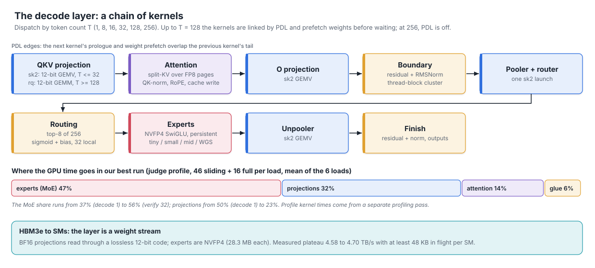

The final layer is 8 kernels at one token and 9 everywhere else, dispatched by token count into seven shape classes.
Up to 128 tokens the kernels are linked by programmatic dependent launch. At 256 tokens PDL is off, because it measured
-1.5% at verify-32 sliding. Each projection kernel gets a PDL word telling it how many weight stages to issue
*before* `griddepcontrol.wait`, because its weights don't depend on the previous kernel. Attention issues its page-index
copies before the wait and prefetches a 4 MB prefix of the pooler's weights into L2 at one and eight tokens.

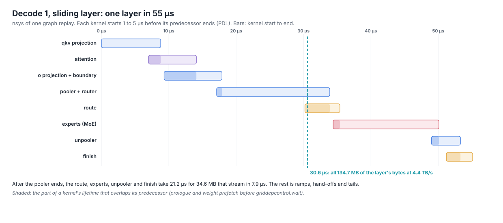

At decode-1 sliding the layer streams 134.7 MB, which is 30.6 µs at 4.4 TB/s, and takes 55 µs. Every kernel starts 1 to
5 µs before its predecessor ends. The loss is visible at the end of the chain: after the pooler, 34.6 MB that stream in
7.9 µs take 21.2 µs, because route, experts, unpooler and finish each pay a ramp, a hand-off and a tail.

A persistent layer kernel doesn't help. A grid-wide data-flag hand-off inside a streaming kernel cost 1.4
to 1.6 µs with the ring still streaming, and every fusion that traded a PDL boundary for a hop like it lost (below). Every
scheme that used "idle" HBM in the shadow of a latency-bound kernel lost, for the same reason the e-graph's
hoisted form lost: background traffic stretches the critical path. Pooler stages before the wait (-1.1% at decode 1),
`o` pre-issuing into attention's window (-0.18%), L2 prefetch in every GEMV (0.949), K/V before the PDL wait (-0.45%),
MoE phase-B weights into L2 after routing (x0.89 to 0.92), the route kernel prefetching expert weights from one SM at
about 250 GB/s (+52 µs at decode 1). Three small ones survived: the base's 4 MB pooler prefix, an unpooler prefetch at
up to 16 tokens (+0.14%), and the MoE pre-issuing two units per CTA at its wait.

### The structural bets

Over the run the agents built the redesigns the profiles seemed to call for, most of them on November 1 and 2, and the
cluster MoE on November 4. All were measured on an H200, on the judge or on our pipeline, and all lost:

| Idea | Predicted | Measured | Why it lost |
|---|---|---|---|
| decoder warps + tensor warpgroups for the big MoE | +2 to 3% | layer 1.62 to 1.68x against 2.238x | halved the warps that decode, which was the bottleneck |
| folding route / finish into the pooler / unpooler | +0.3 to 0.5% | +21 to 27 µs at 1 and 8 tokens | a grid hop replaced a PDL boundary |
| routing inside the MoE prologue | save the 2.4 µs route kernel | MoE 37.7 vs 16.6 µs at decode-1 sliding (nsys) | 17.5 µs of cold one-shot code |
| unpooler and finish inside the small MoE | save about 4.3 µs | 0.986 and 0.980 | a second grid barrier and an 8.4 MB burst ahead of the first expert units |
| CTA-local MoE (one grid barrier, `red.add`) | remove the A-to-B hand-off | MoE x0.57 to 0.65 | 16 to 24 GB/s per SM; the base's hand-off only cost 1 to 3.5 µs |
| small MoE without the grid barrier | -0.2 to -1.5 µs | -4.5% / -1.6% at decode 1 | per-slot completion costs more than one barrier |
| cluster K-slice MoE | +3.3 to 4.1% | 172.6 vs 141 µs at decode-32 sliding (200-rep screen) | clustered grids hold 120 SMs; cluster release lowers to `MEMBAR.ALL.GPU` |

The dead list's own summary by November 2: "Not to trust: any gain model for a structural change ... the record is 0 for 12
on sign." Only direct measurements of small, local changes held up.

### Attention

Attention is one split-KV FP8 kernel family, about 5,200 lines after the rewrite. Each CTA computes a partial softmax over
64-key tiles against a fixed reference of 2^0, so the merge is a plain add, and the last arriver (or every split, when the
whole grid is resident) normalizes, applies RMSNorm and the sigmoid gate, and resets the workspace. The merge flavour is
chosen per case: two TMA bulk reduce-adds at decode-1 sliding (Madhavan113's design), one 4,608-byte bulk reduce-add at
decode-16 sliding, `red.v4` at decode-32 sliding, BF16x8 atomics in verify. The split plans were swept per case: halving
the splits cost 0.7 to 5.5 µs, removing them 16 to 39 µs, and more splits gained nothing except verify-16 sliding, where
the TPE study's 11 splits (+0.81%) replaced a default that left only 7 of 8 splits non-empty.

The two kinds of layer behave differently:

- **Sliding layers are latency chains.** The K/V traffic is 0.5 MB at one request. Shared-memory stamps showed the chain:
  page indices, K/V, math, merge counter, finalize, each hop 0.5 to 2 µs, with the critical CTA always the last counter
  arrival. A no-math skeleton with the same traffic, page lookups and merge took 5.1 µs at one request against the base's
  5.7. The cuts that won attacked hops: the epoch word as a 16-byte `cp.async` instead of a synchronous load (+0.24%),
  gates staged before the CTA join (+0.32% at verify-1 sliding), no sleep in the counter poll (+0.38%), BF16 partials at
  verify 1 (+0.70%), relaxed loads for failed polls (+0.04%). Five variants of the verify-1 tail lost 0.5 to 1.05%, and
  three cluster merges lost 0.96 to 1.78%.
- **Full layers sit on a gather ceiling.** With page size 1 every K/V row is a random 128-byte read, and `cp.async` tops out
  at 3.80 TB/s (see the H200 section). Decode-32 full's attention took 166 to 172 µs against 171 µs of pure delivery at
  that rate, and decode-16 full 84.6 to 88 against 84.5. Over four days the judge's per-kernel times for attention fell 6
  to 13% on the short sliding chains and 0% on decode-16, decode-32 and verify-32 full.

The verify kernels gained the most on the last night, from four mechanisms: writing the e4m3 query tile in the
prologue, reducing split partials as BF16x8 atomics (half the L2 operations), a stream-K path balanced over requests for
verify-16 full, and the linear exp2 for P from the algebra section. Two bundles of them gave +0.14% and +0.21%, and the
judge's per-kernel attention time at verify-1 sliding fell from 7.2 to 6.5-6.9 µs.

### The MoE

The MoE is about 47% of the layer's GPU time and was 11 of the 22.8 points of score we still had above the model floors on
November 4. One expert is 28.3 MB of NVFP4 weights and scales, 6.4 µs at 4.4 TB/s. There are two designs:

- **The skinny ring** (up to 16 tokens; separate builds for decode 1, verify 1 and decode 16). A persistent kernel on 132
  CTAs: 8 compute warps holding x slices in registers, a helper warp for the epilogues, and later an issuer warp. A unit is
  a 16-row block of an expert over the full K, 36 KB, streamed through a 3-slot TMA ring. Phase A is gate/up with SwiGLU in
  the helper's epilogue, phase B is down, handed over by a credit counter or by data flags polled straight from L2. The
  steady state runs at 4.34 TB/s, 99% of the ring's rate. The loss is at the edges: at decode-1 sliding the helper picks
  up unit 0's partials 2.6 µs late, its first epilogue costs 1.4 to 2.4 µs of cold code, and the last A credit lands 11 to
  14 µs in.
- **WGS** (32 tokens and up). 576 threads with four consumer warpgroups doing register-A wgmma on weights they decode
  themselves, cost-weighted stream-K over stages, units split between two CTAs finished by a designated CTA.

Most adopted MoE changes are about those edges, and none of them is big: the A credit as one GPU-scope fence plus relaxed
adds, with partials handed to the helper before the refill (+0.58% on six cases, one of only six changes that read "ahead"
of noise); a dedicated issuer warp for ring refills (+0.30%); a fourth ring slot at one token (+0.42%); expert picks by
warp ballots (+0.26%); keeping role branches warp-uniform, which removed 2 or 3 waterfall loops per build (+0.27%); the
`route()` frequency fix from the ptxas work (+0.17%); the final pass keeping y rows in registers (+0.14 to 0.49%); and a
retuned cost table for the rare four-tile job at decode 32 (-3.8 µs on the inputs that have one).

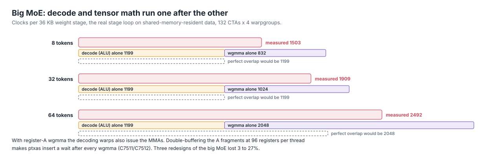

With no weight copies at all, verify-32 sliding's MoE still took 168 µs against 186 µs with them; the HBM stream adds only
16 to 18 µs. The kernel is consumer-bound. Overlapping decode with tensor math looked like about +1%, but a stage-loop
microbenchmark showed a stage costs less than decode plus wgmma, so the hardware already overlaps what it can. A stage is about the decode's ALU issue plus a fixed part plus 20.5 clocks per token, and more overlap would need
double-buffered A fragments, which at 96 registers per thread makes ptxas serialize every wgmma. Every instruction
removed per warp per stage saves about 4.2 clocks at every batch size, so the dqx decode was worth more here than
anywhere.

### Golf

Some of my steering came from playing code-golf CTFs. On November 2 I wrote "Golfing is going to be a big lever I feel. I
have played several golfing CTFs and it feels like that", and after watching one lane over-engineer, "any assert, checks,
bounds etc or unnecessary conditionals and overheads - these things cost a lot when it comes to shaving every ounce of
performance". The first kind of golf is deleting things. Removing guards, checks and dead branches from the device code
gave +1.13% over production (400 repetitions), our largest banked gain at the time, and removing host-side validation about
+0.2%. Not every trim helped: the ones inside the small MoE cost about 1% at decode 1, and one of them, a never-taken
`__trap()`, became the ptxas story below.

On November 3 I asked about the other kind: "do you know about Real Golfing? The kind we used to do in CTFs? Making fewer
operations and code do more stuff?" That question is where the dqx decode search started (below). The same afternoon,
looking at how options were wired into candidates, my CPU habits made me suspicious: "I fear any runtime branching,
conditionals, loops etc can slow things down? Also, certain ops are inherently more expensive than others - its what I
learnt about CPUs". That led to the audit of launch-time selectors described under per-shape specialization below,
and to a compile-time build report that shows each candidate's branches and instruction counts before it reaches a GPU.

### The projections

The projections stream BF16 weights through the base's lossless 12-bit code. `sk2` (up to 32 tokens) is a TMA-ring GEMV with
the weights as the `mma.sync` A operand and the tokens as N. Each weight is a low byte plus a 4-bit sign-and-exponent code
relative to a per-matrix window, and the few weights outside the window are corrected exactly by dedicated escape warps.
`rq` does the same through wgmma at 128 and 256 tokens, and cuBLASLt with pinned plans from an exhaustive plan search covers
the rest. The router is the one piece with a hard numerical constraint (the top-8 must match within 0.05), so it runs in
FP32 up to 8 tokens and as a BF16 hi+lo pair above.

By November 4 stamps showed the pooler streaming at the HBM plateau and the projections byte-paced. What was left were
tails and hand-offs:

- **The router sum off the pooler** (`SK2_RSUM`, +0.51% whole-layer, +0.93% on its 8 cases). The pooler and router run in
  one launch, and their last CTA, elected by a release atomic, read four quarter-K partials and wrote the logits. The change
  leaves the partials where they are and lets the route kernel, which was already waiting on the pooler, add them in the
  same order, so the logits are bitwise identical. It was the largest single change of the last night. Its three siblings that moved
  work *into* the critical kernel lost: the router reduction in its own region (-0.29%), the pooler's CTAs doing all the
  routing (+18.6 µs at decode-16 sliding), and the router first (-1 to -2.5%).
- **Waterfall loops**: issuing copies from a converged, elected producer warp took the `sk2` kernel's bad loops from 118 to
  66 and gained 0.28 to 0.77% at decode 16 and 32, and lost elsewhere, so it ships only there.
- **The 7-op aligned-window decode** (C7) on the cases where it measured best, ring depths per case (+0.35%), and k-warp
  partials as BF16 pairs (+0.25%).
- **What lost**: a variable-length ~11-bit code (0.855, the escape loop is a dependent chain),
  CUTLASS stream-K, ping-pong and multicast GEMMs and our own wgmma GEMM at 128 and 256 tokens, x multicast over clusters
  (-1.04%), 128-CTA qkv over 4-CTA clusters (x0.88 to 0.92), and the pooler at 128 tokens through `rq` (-1.75%).

At 32 tokens every CTA re-reads all of x (48 MB of L2-to-SM traffic for 28 MB of weights at qkv). One fewer x slot costs
1.8 µs and one more buys nothing. We never found out why.

### The clean rewrite

By the evening of November 3 our best file was a research artifact: four near-copies of the attention source of about
190 KB each, five of the MoE at about 145 KB each, 2.66 MB in all, with a cold `prepare` of about 190 seconds against
the judge's 300. I asked for a rewrite from scratch: "why don't we literally just, in a new branch or repo, completely
rewrite our best variant, clean and direct? ... We already have the code reference", and "identical machine code can't
be guaranteed but do check the differences and reason." The rewrite became one CUDA source per kernel family (attention, MoE, `sk2`, `rq`,
glue), a `layer.py` for host code and the per-case build table, and an assembler that writes the single submission file.
Each kernel's SASS was diffed against the old build's. The first assembled file was 0.47 MiB, cold `prepare` fell to about
29 seconds, and it measured the same speed (1.0216 against production). Every change after November 4 landed on it, and
it's the version in [`kernels/decode_layer_src/`](kernels/decode_layer_src/).

### Per-shape specialization

On November 3 two reviewers found launch-time option selectors in about 273 candidate files: byte counts, pointer checks,
phase flags. I had them deleted and made the rule that every variant is a compile-time `-D` switch, off by default and
SASS-identical when off. The organizers' notes that week said many top entries had a kernel per tested shape, and I asked
for the same: "anything that works or adds any benefit to any shape gets used there."

The final file specializes at every level: five attention builds with per-case split plans and merge flavours, nine MoE
builds across six shape classes with their own cost tables (decode-1 sliding even keeps a different weight view, dqm instead
of dqx), per-matrix and per-token-count projection configs, glue by row count, and per-case ptxas options from the study.
It compiles about 53 modules for a per-case candidate and prepares in about 30 seconds cold.

Two warnings came out of the per-shape data. Picking each case's historical best looked like +0.59 to 0.80%, but picking
each case's luckiest *control* reading, with no code change at all, gave +0.77%. And a composite built from the harvest's
regression predicted gains at decode 16 and read -0.85% and -0.60%. Per-case selection from noisy screens is mostly
selection of noise. What we never did was use a different *algorithm* per shape: one big-MoE design serves 32, 128 and 256
tokens, and one attention family serves every case. My guess is that's where the leaders were.

### The final stack

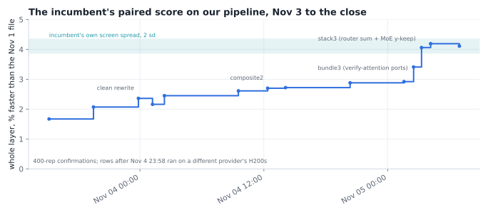

From November 4 at 11:27 to November 5 at 06:56, 43 changes were adopted into the incumbent. Only 6 read "ahead" of their
400-repetition control on the whole layer (the per-case composite, the MoE credit change, split escape corrections, the
async epoch, the verify-attention bundle and the router sum). 37 read within noise, 9 of those slightly negative, and went in
anyway under my rule that every within-noise change stacks. The stack as a whole measured larger than the sum of its
confirmed pieces, which suggests several "within" changes were real but invisible one at a time. Nov 4 as a whole added
about 0.4%; the last night added 1.2%, mostly from the verify-attention bundles and the router sum.

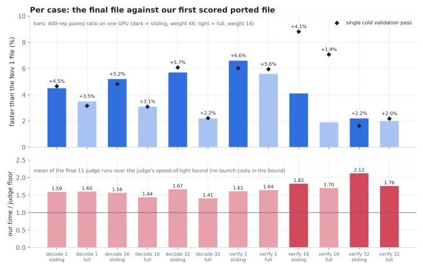

Per case, the gains sat on the cheap, high-weight sliding chains (decode 1, 16 and 32 sliding at +4.5 to 5.7%, verify-1
sliding at +6.6%) and the heavy full cases moved least (+1.9 to 3.1%). The bottom panel shows where we
ended: on most cases our time was 1.4 to 1.7x the judge's speed-of-light bound, and at verify 32 sliding 2.1x.

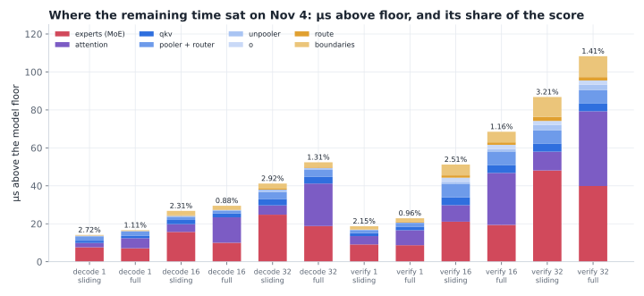

The gap to #1 at the close was 2.614 / 2.342, about 10.4% of time. On the standalone boards, weighting each leader's lead
by our layer's time shares gives about 12%, so the leaders' kernels plausibly account for it. Where it would have to come
from, per our own ledger: the MoE first (48% of the above-floor loss), then attention's sliding chains and verify-full
pipelining, then projections at 16 and 32 tokens and the boundaries at 128 and 256 tokens. At decode-16 and decode-32
full, attention is pinned at the gather ceiling, so a uniform 10% cut there would need 19 to 25% off everything else.

## Searching for better math: the NVFP4 decode

I came into the challenge convinced that the best forms of a computation can be searched for, not only hand-crafted. On
the first night a hand-derived backward pass in my own library had bought 0.6 to 0.9%, and I asked the agents whether there
was a systematic way to find such forms: "there HAS to be some way of 'automatically/deterministically' reducing/transforming
maths and algebra to more optimal froms". In the challenge it paid once at kernel scale.

**The problem.** The MoE's weights are NVFP4: 4-bit E2M1 codes with an E4M3 scale per 16 codes. The tensor cores take
BF16, so every code has to become a BF16 element inside the hot loop. Place a code's
bits (s, e1, e0, m) at BF16 bit positions 15, 8, 7 and 6, and the resulting bit pattern is the E2M1 value times 2^-126,
exactly, for all 16 codes. One `bf16x2` multiply by the block scale times 2^126 then gives the exact product. A 32-bit
word holds 8 codes, which decode into 4 BF16x2 registers, so the question becomes: what is the cheapest sequence of
instructions that moves the stored bits under the mask `M = 0x81C081C0` of four registers?

**The freedom.** `prepare()` is untimed and may repack weights losslessly. So the stored bits can be any bijection of the
original ones, and since the decode will be linear over GF(2), any invertible 32 x 32 GF(2) matrix is allowed, not just a
bit permutation. The search is over instruction sequences and the storage layout together.

**What gets priced.** Not instruction count. Our working cost model, taken from the public write-up below and consistent
with our profiles, was that on sm_90 LOP3, SHF and PRMT issue on the integer pipe while IMAD, FFMA and HMUL2 issue on the
FMA pipe. Our decode loop's profile showed the integer pipe 48% busy and the FMA pipe 42%. A shift written as a multiply
(`x * 4u`) becomes `IMAD.SHL`, so moving shifts there should relieve the busier pipe. We never measured the opcode-to-pipe
mapping directly; the measured speedup below is the evidence that it held well enough.

**The hint.** On November 3 a public write-up by bobrenjc93 said an 8-op decode existed: 4 LOP3 and 1 SHF on the ALU pipe,
3 IMAD.SHL on the FMA pipe, against our inherited 7 + 2. The layout wasn't published. It also contradicted a note in our
own ledger that 13 operations per 8 codes was the floor. I said "we should investigate this well", and two agents went at
it from two sides.

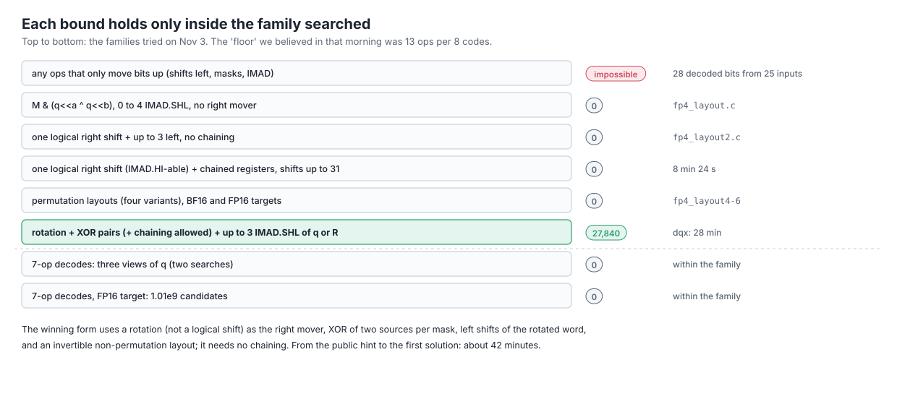

**The search** ([`algebra/fp4_layout3.c`](algebra/fp4_layout3.c)) took about 42 minutes from the hint to a solution:

1. First, a counting proof that no decode built only from operations that move bits upward can exist (shifts left,
   masks, multiplies). Output bit t of such an operation depends only on input bits up to t. The decoded bits at positions
   up to 24 are 7 per register, 28 in all, and they would have to come from only 25 stored bits. So at least one
   right-moving operation is needed. If the mover is an SHF, 4 masks plus 1 mover, 5 integer-pipe ops, is the best that
   family can do. A right shift done by `IMAD.HI` on the FMA pipe would allow 4; we searched that family exhaustively
   up to shifts of 31 and it has no solution.
2. Then exhaustive C searches over widening families, each with GF(2) rank pruning: every register `r = M & (u ^ v)` must
   add exactly 8 independent rows, which kills most partial programs early. Left shifts only: 0 solutions. One logical
   right shift and up to 3 left shifts without chaining: 0. Permutation layouts in four variants: 0.
3. Next the search widened to chaining, where a register can also XOR an *earlier, already masked* register (still one
   LOP3 with M as an immediate). With sources `q`, a rotation of `q` and left shifts of `q`, it found 0 in 5 minutes 36
   seconds.
4. One edge was missing: left shifts of the *rotated* word. With it, the 28-minute run found 27,840 solutions at three
   left shifts, all with rotations by 6, 8, 10, 22, 24 or 26. The first one printed is the one we use. It
   doesn't chain: each register XORs two of `q`, `R` and their shifts.

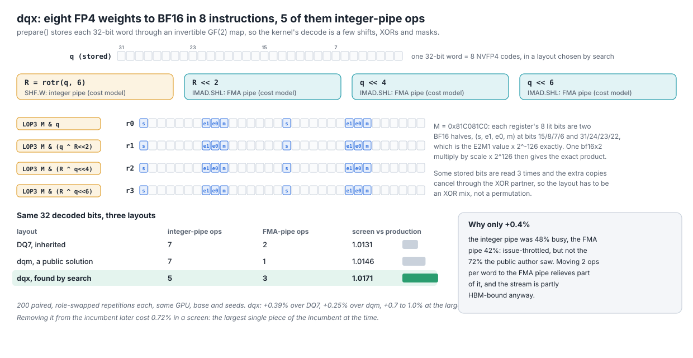

**The proof is linear algebra, not testing.** The decode is GF(2)-linear in the stored word: AND with a constant, XOR,
rotation and a carry-free left shift are all linear. So checking the 32 basis vectors and inverting the 32 x 32 map proves
bit-exactness for all 2^32 words ([`algebra/fp4_layout_verify.py`](algebra/fp4_layout_verify.py)). The script also checks
every byte value at every position and 100,000 random words: "invertible; 101024 checks bit-exact". `prepare()` stores
each word as an XOR of 32 per-bit images. The decode changes no value, so it spends none of the accuracy budget.

**The result.** On the same GPU, base and seeds, with 200 paired role-swapped repetitions each, DQ7 read 1.0131 of
production, dqm (a public solution) 1.0146, and dqx 1.0171: +0.39% over our inherited decode, +0.7 to 1.0% at the large
loads. Removing it from the incumbent later cost 0.72% in a screen. dqx is in the final file for every MoE build except
decode-1 sliding, which kept dqm. It was smaller than the public author's +1.8% because our ALU pipe wasn't as busy as
theirs, a prediction the agents made before measuring.

The search used no SMT solver. Z3 and SymPy proved scalar and vector rewrite rules elsewhere
([`algebra/proofs.py`](algebra/proofs.py)).

**Every bound is only as wide as its family.** That morning we believed 13 ops per 8 codes was the floor. It fell in 42
minutes to a wider family (XOR-mix layouts, two sources per mask, shifts of the rotated word). Afterwards three separate searches found no
7-op decode, including 1.01 billion candidates for an FP16 target. Those are statements about the families searched.
PRMT-based decodes and three-input LOP3s were never searched.

### The same machinery elsewhere

- **The 12-bit weight code** (from the base) stores a BF16 weight whose exponent sits in a 16-wide window as 12 bits,
  decoded with integer ops, with out-of-window values as escapes corrected exactly by a small extra MMA. It cuts the dense
  projections' bytes by 25% and is lossless for any weights, which I confirmed as a ruling on November 1 after it was
  shown to be worth 5% on the base layer. An aligned-window variant ("c7") scales the whole matrix by an exact power of
  two so the window starts at a multiple of 8, turning an add into an OR: 7 ops per 8 weights instead of 8. It ships only
  for decode-16 full, where it measured best.
- **Exhaustive numeric checks caught two "exact" rewrites.** SiLU as x/2 (1 + tanh(x/2)) is an identity and saves 8 to
  16 instructions, but for x < -8 the `1 + tanh` cancels: up to 13,810 BF16 ulp, found by checking all 65,536 BF16 inputs.
  The repaired form handles the tail as x eˣ/(1 + eˣ). The same sweeps over 38.8 million inputs ranked exp2 forms:
  `ex2.approx.f32` is off by at most 1 ulp, the f16x2 form by 13,183.
- **A linear exp2 when P becomes FP8 anyway.** In verify attention, P's e4m3 code comes from one FFMA with a magic
  constant, with no MUFU and no conversion. The approximation is a bounded reweighting of the attention weights: the row
  sums are produced by the same FP8 MMA over the same approximate P, so the error cancels between numerator and
  denominator. It is in the final file.

### Whole-layer algebra: an e-graph and its cost model

A separate agent, whose brief was "change the computation, not the schedule", wrote the layer's math as an egglog
e-graph with 33 rewrite rules (linearity, constant diagonals folded into prepare-time matrices, associativity), proved
each rewrite with SymPy or Z3 and the whole restructured front half against the reference in float64 (errors around
1e-15), and extracted the cheapest form with a greedy DAG extractor and an exact MILP.

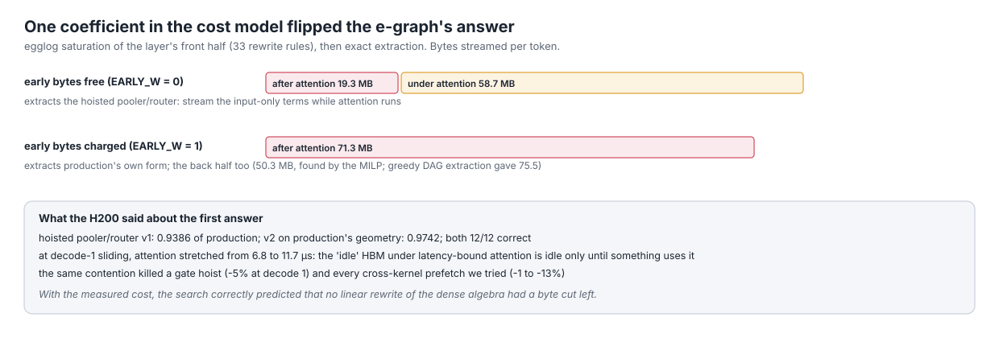

Its first cost model treated bytes read while attention runs as free, because attention is latency-bound and HBM looks
idle. Under that model the best form hoists the pooler and router's input-only terms under attention. On the H200 that
form read 0.9386, and 0.9742 on production's geometry: the extra traffic stretched attention one for one, from 6.8 to
11.7 µs at decode-1 sliding. With early bytes charged in full, the same e-graph extracts production's own form for both
halves of the layer. Under the measured cost there was no byte cut left in the dense algebra; what remained were
hand-offs, dependent levels and instruction-level changes.

Seven exact reformulations came out of the map, predicted at +0.2 to +2.5% each. The ones that were measured came back
neutral or negative.

One piece of the front half did land. After attention, the reference computes

```
a   = O z                          # o projection
s1  = α1·s + β1·a / rms(a)         # residual boundary
h   = (1 + w) · s1 / rms(s1)       # RMSNorm
logits = R h ,  pooled = P h       # router and pooler
```

The boundary has two dependent reductions: `rms(a)` must finish before `s1` exists, and only then can `rms(s1)` start.
Expanding the square removes the dependency:

```
Σ s1²  =  α1² Σ s²  +  (2 α1 β1 / rms(a)) Σ s·a  +  (β1² / rms(a)²) Σ a²
```

`Σ s²`, `Σ s·a` and `Σ a²` are independent row sums, so one pass computes them all and `rms(s1)` follows from `rms(a)`
with scalar math. Z3 proves the identity over the reals ([`algebra/proofs.py`](algebra/proofs.py)), and a float64 check
over 500 random tokens bounds the FP32 error. At one token the layer already used this form, with the o projection's
epilogue emitting the row moments. On the last night an agent applied the same expansion to the cluster boundary used
from 2 to 8 tokens (`GLUE_RMOM`): r1, r2, the router copy's norm and the residual carry from seven row moments in one
DSMEM exchange instead of two. It read within noise (+0.08% on its two cases) and stayed in the stack. What it saves is
a dependent round, not bytes.

### Spending the accuracy budget

The rules allow error within 2.5x the reference's own error with FP8 queries (3 to 15% depending on the shape), with
routing allowed to differ only at near ties. Early on the orchestrator kept about a 2x safety margin for the organizers'
reruns on held-out data. I asked "Why have unnecessary precision when the challenge doesnt need it?", and the rule became:
spend each gate's whole budget, and keep a change if the worst of 50+ seeds of the judge's own input generator stays
under the gate.

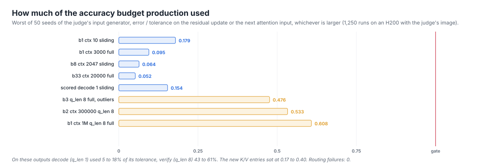

The ledger showed how much room there was: decode used 5 to 18% of its tolerance on the main outputs, verify 43 to 61%.
FP8 P, BF16 partials, a BF16 hi+lo router and the approximate exp2 spent some of it. The budget has to be measured on
adversarial, held-out-style inputs, not random ones. A scale encoding that was lossless
only on the synthetic weights' range, the tanh SiLU, and the attention RMS form below all passed on random inputs.

**The attention RMS bug.** The attention finalizer computed the output norm from unnormalized softmax numerators,
algebraically equal to the norm of the normalized mean and one divide cheaper. But the squares can overflow FP32 where
the sums don't. An agent probing adversarial inputs built a reproducer with aligned cached keys: relative L2 error 0.345,
eight heads collapsed to zero. The 13 task tests never hit it, and the file on the board had it. Normalizing first fixed
it (0.0054). Every file in the final burst carries the fix.

## Reverse engineering ptxas

When the obvious levers ran out, a never-executed line of code started to bother me. The MoE's tiny builds carried
`if (nF > 0) __trap();`, a branch that never runs, and writing it three different ways moved cases by ±0.5 to 1.1%. The
source comment said the trap "lets the compiler drop their share". Nobody had checked. I asked the agents to find out
what was going on and to build a theory of the GPU from everything we had measured. An agent spent 7.5 hours on
ptxas 13.0.88, the judge's exact binary, on a rented CPU box: compiling small PTX, reading SASS with `cuobjdump` and
`nvdisasm`, diffing, and only then screening a recipe through the pipeline so every claim of speed carried a
measurement. The full notes are in [`notes/ptxas-re.md`](notes/ptxas-re.md) and the tools in
[`harness/ptxas/`](harness/ptxas/).

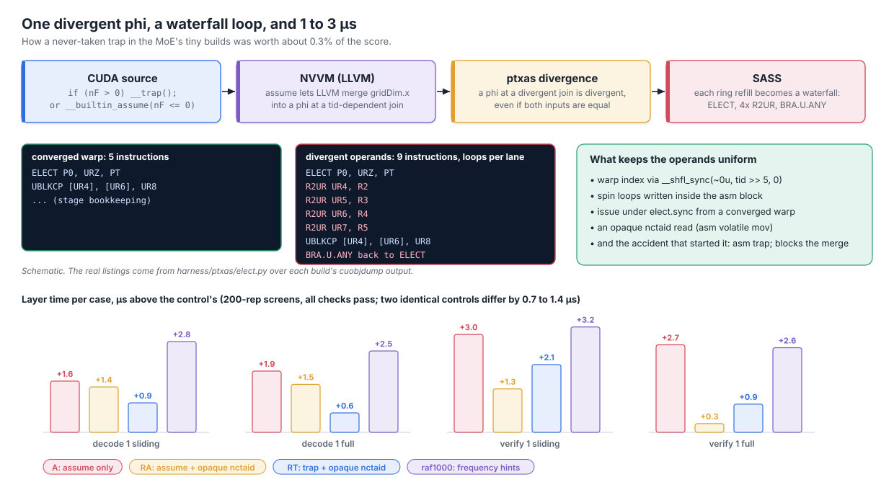

**The trap.** NVVM, not ptxas, made most of the difference. `__builtin_assume(nF <= 0)` lets LLVM delete the fat-share
arithmetic (5,328 SASS instructions down to 5,072), while `__trap()` lowers to inline asm that LLVM doesn't treat as
noreturn, so it gives LLVM no range fact. The comment was false. But the `assume` form was slower, and the reason was
divergence. With the trap gone, NVVM merged a `gridDim.x` read with the same read inside an earlier thread-dependent
branch, producing a phi at a divergent join. ptxas's divergence analysis treats a phi at a divergent join as divergent
even when both inputs are equal, so the ring's bulk-copy operands became divergent, and each of the four ring refills
compiled into a waterfall loop: `ELECT`, four `R2UR`, `BRA.U.ANY`, 9 instructions instead of 5. The asm `trap;` had
blocked the merge by accident. A minimal PTX reproduction confirmed the rule: `tid == 64` or `(tid >> 5) == 2` gives bad
loops, `__shfl_sync` of the warp index or a kernel parameter gives good ones. An opaque `nctaid` read recovered about
60% of the loss. The trap stayed.

**Frequency hints change collective lowering.** `.pragma "frequency n"` is a block execution-count hint that NVVM never
emits; the only way in is inline asm. Weighting the unit loop 1000x made `route()` 1.5 to 1.9 µs slower, because its
blocks counted as cold and ptxas dropped the `BRA.DIV` fast path for `MATCH.ANY` and `__syncwarp`, running the warp-
collective emulation inline every iteration. The fix that kept `route()`'s collectives converged (`MOE_RAFN`) was
predicted at +0.37% and confirmed at +0.17% on its cases. It is the one finding with a clean line from mechanism to fix
to adoption.

**Uniform registers are fragile.** A uniform value with a kernel-long live range can end up in a vector register and be
`R2UR`'d at every use. NVVM CSEs every shared-memory symbol reference into one kernel-entry `mov`, and in the cluster MoE
that put 32 `R2UR`s into each stage loop (367 to 384 instructions against the incumbent's 288 to 293). A local
rematerialization fixed it, and then adding one owner warp flipped it back. Instrumentation does the same: a debug
build or any timestamp in the consumers' stage loop adds about 100 instructions per stage, so early stage timings
measured a slower program. The rule we sent every lane: re-check the stage loop's shape after every structural change.

**What `MEMBAR`s hide.** Scope decides the SASS. A remote `mbarrier.arrive.release.cluster` becomes `MEMBAR.ALL.CTA`,
`MEMBAR.ALL.GPU`, two error barriers and the arrive; the default `.release.cta` form is the arrive alone.
`try_wait.acquire.cluster` adds an SM-wide L1 invalidate. `MEMBAR.ALL.GPU` waits for the warp's outstanding global
reductions, which cost the cluster MoE 4 to 5 µs per item, about 70% of its first build's gap.

**Other findings:**

- **`setmaxnreg` drops silently.** If code reachable from both register budgets follows the donation, ptxas drops every
  `setmaxnreg` (C7507, visible only with `-v`) and spills. Our build tool now prints every `C7xxx` code.
- **ptxas serializes every wgmma** in a kernel when it can't prove register hazards across commit groups (C7510 to
  C7515). That killed several ideas at compile time with no GPU spent.
- **FP8 `mma.sync` is emulated on sm_90a:** each `m16n8k32` e4m3 becomes 12 `F2FP.UNPACK` and 2 `HMMA.16816`. Only wgmma
  is real FP8.
- **Knobs are closed in the release build.** `-knob` is an unknown option, knob pragmas warn or error, and
  `DUMP_KNOBS_TO_FILE` does nothing, despite what a public reverse-engineering reference
  ([crucible-notes/ptxas](https://gh.evko.io/crucible-notes/ptxas)) suggested for this exact binary.
  `.pragma "local_maxnreg N"` is accepted and works as a per-function register cap, with one hazard: above the launch cap
  it allocates anyway, and the kernel can fail to launch.
- **Code motion around waits.** The first `TRYWAIT` of an mbarrier spin stays inline and the retry block moves to the
  function's end; loads never move above the wait. Before a wgmma `wait_group`, an independent global load is hoisted,
  a shared load is not. Peeling the first MMA with a zero accumulator encodes `RZ`, so no zeroing code exists.
- **ptxas option dials** (`--register-usage-level`, `--def-load-cache`) gave at most +0.08% in the per-case study and
  -1.04% at worst.

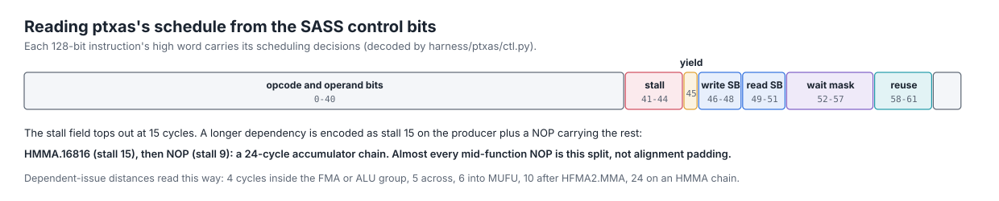

The control bits gave us ptxas's own latency model for free: 4 cycles between dependent instructions inside the FMA or
ALU group, 5 across, 6 into MUFU, 24 on an HMMA accumulator chain. Nearly every mid-function NOP is the second half of a
stall longer than 15 cycles, not alignment padding, and ptxas doesn't align loop heads at all. That closed the
"alignment" theory for the trap.

Before any of this, SASS was already our equivalence oracle. The dead-code pass compiled every build both ways and
compared each function's SASS (18 changed builds, all identical), and the clean rewrite was checked kernel by kernel
against the old builds with a register-renamed diff. 89 commit messages cite "SASS-identical".

Most of the fixes were neutral or negative. The ones that shipped were the `route()` fix, a per-case elect variant (+0.16% on its cases), and removing
false warp divergence in the MoE roles.

## A Lean model of PTX on the H200

On November 4 I asked whether we could build a high-fidelity Lean 4 model of the H200 and PTX, from NVIDIA's
documentation, public microbenchmarks and our own measurements, with no `sorry` and no axioms standing in for hardware
facts. "no point if our axioms are wrong", I wrote. An agent wrote about 4,900 lines of Lean in about a day, on a rented
CPU box after its model checker ran my PC out of memory.

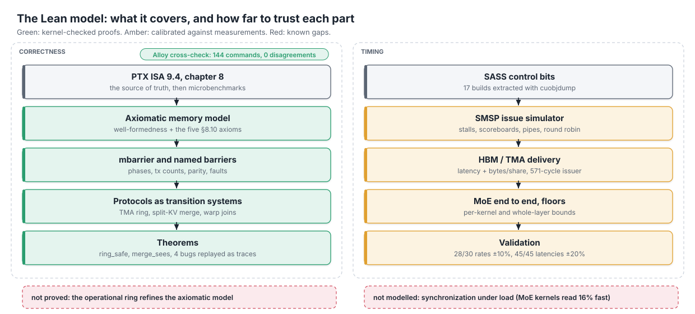

- **The PTX memory model,** transcribed from chapter 8 of the PTX ISA 9.4: well-formedness and the five axioms of §8.10,
  relations as finite tables, litmus enumeration. A cross-check against NVIDIA's mixedproxy Alloy model ran 144 commands
  with 0 disagreements, and found three defects in the Alloy artifact: fences carry no proxy, so no fence-based
  release/acquire ever synchronizes and the ISA's own message-passing example is allowed; a reduction's read starts no
  acquire pattern; and the Fence-SC check never fires. The first relation code re-evaluated exponentially (120 s for an
  8-event test); tabulated matrices took it to 0.16 s.
- **mbarrier and named barriers,** with phases, transaction counts, parity waits and every fault the ISA describes.
- **Protocol proofs, kernel-checked.** Our TMA producer/consumer ring is safe for any slot, consumer, producer, byte and
  stage count with matching barrier counts (`Ring.ring_safe`), and the split-KV merge's last split sees every partial in
  the PTX memory model (`SplitMerge.merge_sees`), for any number of splits. An independent audit of the first version
  returned 11 findings, including a `consistent` predicate with no well-formedness at all; all the P1s were fixed before
  the proofs were built on it. Not proved: that the operational ring refines the axiomatic model.

  In `ring_safe` there are S slots, each with a full and an empty mbarrier. Stage q uses slot q mod S
  and parity (q / S) mod 2. A producer waits on the slot's empty barrier for the previous round, posts its expected bytes
  on the full barrier and issues the copy, whose pieces complete the transaction as they land. Each consumer waits on the
  full barrier's parity, reads, and arrives once on the empty barrier. The theorem says that for every valid
  configuration (full barriers initialized with the producer count, empty barriers with the consumer count, byte counts
  in range) no reachable state faults: no mbarrier is over-arrived, re-armed before its last phase was observed, or waited
  on with a stale parity; no consumer acquires a slot before all of its stage's bytes have landed; and no producer
  overwrites a held slot. Concrete instances, such as the big MoE's 3 x 36,864-byte ring with 16 consumer warps, show it
  isn't vacuous. In the model, TMA, bulk copies and wgmma appear only as bytes landing on mbarriers. `setmaxnreg`,
  PDL, the tensormap proxy and mixed-size accesses are outside it, and visibility of the copied data is taken from
  mbarrier completion rather than proved in the memory model.
- **Four of our sync bugs replayed as traces:** a joined-TMA barrier initialized with count 1 instead of 2, mismatched
  counts on one named barrier, a warm-up warp aliasing the helper's index and arriving twice, and a start-join deadlock.
  Each was already known from a test failure or a review, and the model accepts each fix. It never found a new one.
- **A timing model** driven by the real SASS control bits (17 builds), with an HBM/TMA delivery model and per-kernel
  floors. It matched 28 of 30 TMA streaming rates within 10% and all 45 ring latencies within 20%. On the MoE kernels end
  to end it ran 16% fast on average (worst 32%), because it doesn't model synchronization under load.

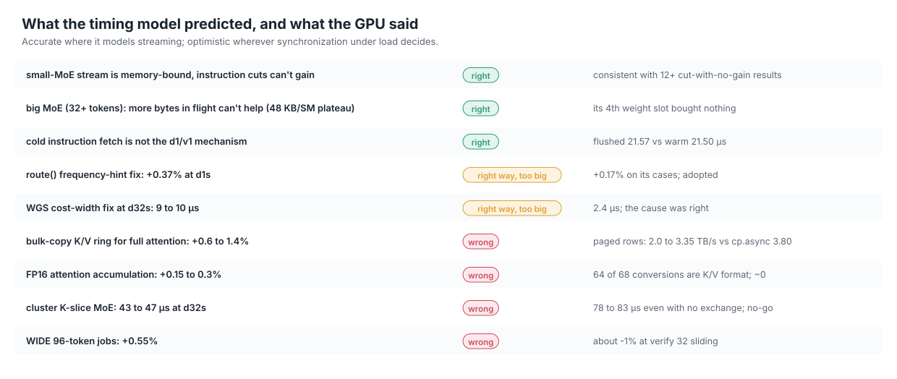

It was accurate on streaming and optimistic on synchronization, which is where the time was. It was a useful correctness
and science tool and a poor oracle for speed: it modelled our kernels, not alternatives to them, and we used it to rank
levers inside a design we had inherited, when the gap needed a different design. It did rule out instruction delivery as the decode-1 loss, point at the decode-32 straggler before
anyone measured it, and show that no leader needed any of its parameters to be wrong.

We are turning it into nvgpu-lean, an open PTX/SASS machine model for NVIDIA GPUs: run a kernel without a GPU, prove it correct under
the PTX memory model, and measure how far it is from a lower bound. The ptxas findings above become executable checks in
it. It isn't ready yet, and I'll share it when it is.

## The last morning

At 03:23 UTC I decided to stop scored runs until the last 15 to 30 minutes, then use the remaining ones together. Adoption
froze at 07:00. At 07:29 the orchestrator submitted the best file and each distinct confirmed variant; four of the first
seven produced no job and were resubmitted at 07:38. Eleven scored runs in ten minutes, scoring 2.306 to 2.342x.

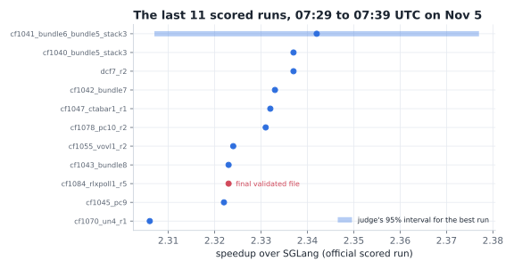

The board shows the best draw, an older bundle at 2.342x. The final incumbent, with every adopted change stacked and fully
validated, drew 2.323x. The eleven spread over 1.5%, about one run's noise.

## What's in this repo

| Path | What it is |
|---|---|
| [`kernels/decode_layer_best_run.py`](kernels/decode_layer_best_run.py) | the decode-layer file behind our board row: 2.342x, job `5fcec3e5` |
| [`kernels/decode_layer_final.py`](kernels/decode_layer_final.py) | the final validated incumbent: 2.323x on its scored run |
| [`kernels/decode_layer_src/`](kernels/decode_layer_src/) | the final decode layer as readable sources, with `assemble.py` |
| [`kernels/attention_decode.py`](kernels/attention_decode.py), [`moe_w4a16.py`](kernels/moe_w4a16.py), [`bf16_proj.py`](kernels/bf16_proj.py), [`prefill_layer.py`](kernels/prefill_layer.py) | the other boards' submitted files |
| [`harness/`](harness/) | the judge-style harness, bench server, queue and relay, screens and confirmations, the TPE study, submit tooling, box scripts, ptxas tools |
| [`data/`](data/) | scored runs, rank history, per-case timings and time shares, HBM benchmark, pipeline throughput, lanes, the adopted-changes ledger, every screened candidate |
| [`algebra/`](algebra/) | the decode searches, the exactness proof, the e-graph and the rewrite proofs |
| [`notes/`](notes/) | working notes from the run: ptxas, GPU theory, judge measurements, dead ends, attention's final state |
| [`figures/`](figures/), [`scripts/`](scripts/) | every figure as SVG; `svgkit.py` holds the shared style, `diagrams.py` the hand-built diagrams, `make_figures.py` draws everything |

The kernels need the challenge's image and its harness files (`reference.py`, `baseline.py`, `TASK.md` from `okc init`),
which aren't mine to redistribute.

## Credits

- [keell0renz](https://github.com/keell0renz/muse-open-kernel-challenge): the base of every board, the lossless 12-bit
  weight code, and their `LESSONS.md`.
- The code that base builds on, credited in each file's header: [vjeux](https://github.com/vjeux/okc-2026),
  [alygg77](https://github.com/alygg77/okc-muse-spark-kernels), chenwainuo, ZhimaoL (verify-attention WST and the prefill
  FMHA), Madhavan113 (the TMA bulk-reduction merge), Matsvei, and NathenFernandes (MIT).
- bobrenjc93's public write-up, whose description of an 8-op NVFP4 decode started our search.
- [EAT](https://github.com/caoshiyi/EAT) by Shiyi Cao et al., for the supervisor-and-roles loop.
- [lxe's write-up](https://lxe.co/muse-swarm/), for fresh agents per attempt and spot GPUs.
- The public [ptxas 13.0.88 reverse-engineering notes](https://gh.evko.io/crucible-notes/ptxas).
- NVIDIA's [mixedproxy](https://github.com/NVlabs/mixedproxy) Alloy model, our cross-check for the memory model.
- The organizers of the Open Kernel Challenge, for the problems, the judge and its per-case profiles.

The code is under the Apache License 2.0 (see [`LICENSE`](LICENSE) and [`NOTICE`](NOTICE)), as is the code it builds on.
